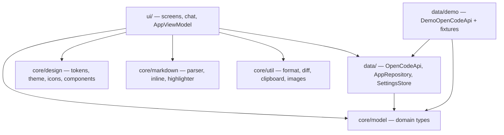

# Architecture

## Purpose

EdgeCode is a client for an OpenCode server: it connects to a host running
`opencode serve`, lists that server's sessions, and drives them — sending
prompts, streaming replies, approving tool calls, switching models and agents.

The app is built and installed entirely on-device, in Termux. That single fact
explains most of the decisions below.

## Constraints

| Constraint | Consequence |
|---|---|
| Builds run on the phone (~1.5 GB free RAM, minutes per build) | One Gradle module, few dependencies, no code generation |
| The v1 event stream is documented as lossy | Streaming is a delta channel; REST is the source of truth |
| Assistant text arrives a few characters at a time | Markdown must render incomplete input, and re-render cheaply |
| Tool output can be unbounded | Truncation and collapsing are correctness features |
| Attachments travel as base64 data URIs in the prompt | Decode downscaled, cap sizes, never hold a full-size bitmap |
| LAN servers are usually plain `http://` | Cleartext must be explicitly permitted |

## Layering

The load-bearing rule: **the UI only knows `core/model`.** Nothing above `data/`
may reference a wire format. That is what lets the demo be replaced by a real
client without touching a single screen.

| Component | Responsibility |
|---|---|
| `core/model` | `SessionSummary`, `ChatMessage`, `Part`, `ToolState`, `PermissionRequest`, `ServerEvent`, … |
| `core/design` | Colour, typography, spacing, radius and motion tokens; `EdgeTheme`; `EdgeIcons`; shared components |
| `core/markdown` | `Markdown.parse` → blocks, `renderInline` → `AnnotatedString`, `SyntaxHighlighter` |
| `core/util` | Number/date formatting, unified-diff parsing, clipboard, bitmap decoding |
| `data/OpenCodeApi` | The API seam and `ChatReducer` (pure event reduction) |
| `data/AppRepository` | Owns the API, subscribes to events, exposes `StateFlow`s, performs actions |
| `data/demo` | `DemoOpenCodeApi` and fixture content |
| `ui/AppViewModel` | Navigation stack, selection state, settings writes |
| `ui/screens`, `ui/chat` | The four destinations and the transcript components |

## Data flow

**Connect.** `ConnectScreen` → `AppViewModel.connect` → `AppRepository.connect`
→ `OpenCodeApi.health()`. Only on success is the profile persisted and the
navigation stack replaced with Sessions. On failure the `ConnectionState.Failed`
carries the message the banner shows.

**Open a session.** `openSession(id)` marks the chat state loading, fetches
`OpenCodeApi.messages(id)`, then pushes the Chat destination. Because the fetch
is a plain list, re-entering a session re-fetches rather than trusting whatever
the event stream happened to deliver.

**Send.** `Composer` → `AppViewModel.send` → `AppRepository.sendPrompt`. The
optimistic user message is not constructed locally: the API emits
`ServerEvent.MessageUpserted`, which is reduced into state by the same path a
remote event would take. Local and remote behaviour are identical by design.

**Stream.** `DemoOpenCodeApi` plays a script: reasoning, then text, then tool
calls, emitting `PartUpserted` for the same part id as content grows. The
transcript keys `LazyColumn` items by message id, and parts are replaced in
place by id, so a token arriving does not rebuild the list.

**Approve.** A scripted step emits `PermissionRequested` and then *suspends* on a
`CompletableDeferred` until `respondPermission` completes it. The sheet is
therefore a real blocking round-trip, not a mocked animation.

## State model

- `AppRepository` holds `StateFlow`s for connection, sessions, permissions and
  the catalog, plus one `StateFlow<SessionChatState>` per opened session.
- All mutation of that state goes through `ChatReducer`, a set of pure functions
  `(State, ServerEvent) -> State`.
- `ChatReducer` has no Android or coroutine types. The bulk of the app's real
  complexity — merging streaming parts, reconciling a stale frame — is therefore
  testable on the JVM without a device.

## Transcript layout

The chat list uses `reverseLayout = true`, with messages reversed so the newest
sits at index 0. This is not cosmetic: streaming content grows continuously, and
anchoring the newest item to the bottom means growth extends upward naturally
instead of fighting the scroll position. "Jump to latest" becomes
`animateScrollToItem(0)`.

## Design decisions

| # | Decision | Rationale, and what was rejected |
|---|---|---|
| 1 | One Gradle module | Multi-module multiplies on-device build time for no benefit at this size; boundaries are enforced by package instead |
| 2 | Hand-rolled markdown renderer | **compose-richtext** (1.0.0-alpha05) was evaluated and rejected: an alpha dependency on the most design-critical and streaming-critical path, and it renders code blocks as plain styled text, so our code chrome (language label, copy, collapse, horizontal scroll) would still need a custom renderer |
| 3 | Hand-authored `EdgeIcons` | `material-icons-extended` is ~35k generated classes to dex on a device with ~1.5 GB RAM. A 24dp grid, 1.8dp stroke and round caps also yields a more consistent icon voice than a mixed pack |
| 4 | Hand-rolled navigation stack | Four destinations, one-line back behaviour. Avoids a dependency and keeps transitions under our control |
| 5 | No image loading library | Attachments are a small bounded set, never loaded from the network; `ImageDecoder`/`BitmapFactory` with bounds sampling is ~60 lines |
| 6 | Manual DI | The object graph is a ViewModel, a repository and a settings store. A framework would obscure it |
| 7 | `SharedPreferences`, not DataStore | Settings are six scalars read once at startup; DataStore's flow machinery earns nothing here. Passwords are deliberately *not* persisted |
| 8 | Dark is the default theme | Matches the reference clients and how the app is used; light and follow-system are one tap away in Settings |
| 9 | API seam is an interface, not a client | The demo and the future v1 client implement the same `OpenCodeApi`, so the UI cannot tell them apart — except for the "Sample data" chip |
| 10 | Optimistic writes go through the event stream | Guarantees the local and remote paths are exercised identically, which is what makes the demo a real test of the UI |
| 11 | Conservative syntax highlighting | Only comments, strings, numbers and a small keyword set. Aggressive per-language highlighting is confidently wrong more often than it is right |

## Invariants

1. Nothing above `data/` imports a wire-format type.
2. `ChatReducer`, `Markdown`, `SyntaxHighlighter`, `Diff` and `Format` stay free
   of Android types.
3. Colour comes from the theme; geometry comes from `Tokens`. No literals in
   feature code.
4. Every part update reuses its part id, so identity is stable while streaming.
5. Demo and real implementations both drive `ServerEvent`.

## Extension points

| Goal | How |
|---|---|
| Implement the real client | Add `data/opencode/V1Api : OpenCodeApi`; construct it in `AppRepository.connect` instead of `DemoOpenCodeApi` |
| Support the v2 server | Add `V2Api : OpenCodeApi` and probe at connect (`GET /global/health` vs `GET /api/info`) |
| Add a screen | Add a `Screen` case, a branch in `EdgeApp`, and a composable under `ui/screens` |
| Add an icon | Add a vector to `EdgeIcons` on the shared 24dp grid |
| Change the look | Edit tokens in `core/design/Tokens.kt` and `Theme.kt`; no screen edits should be needed |
