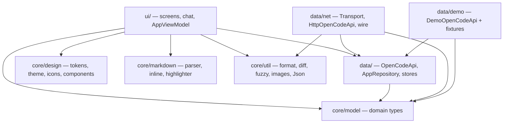

# Architecture

## Purpose

EdgeCode is a client for an OpenCode server: it connects to a host running
`opencode serve`, lists that server's sessions, and drives them — sending
prompts, streaming replies, approving tool calls, switching models and agents.

The app is built and installed entirely on-device, in Termux. That single fact
explains most of the decisions below.

## Constraints

| Constraint | Consequence |
|---|---|
| Builds run on the phone (~1.5 GB free RAM, minutes per build) | One Gradle module, few dependencies, no code generation |
| The v1 event stream is documented as lossy | Streaming is a delta channel; REST is the source of truth |
| Assistant text arrives a few characters at a time | Markdown must render incomplete input, and re-render cheaply |
| Tool output can be unbounded | Truncation and collapsing are correctness features |
| Attachments travel as base64 data URIs in the prompt | Decode downscaled, cap sizes, never hold a full-size bitmap |
| LAN servers are usually plain `http://` | Cleartext must be explicitly permitted |

## Layering

The load-bearing rule: **the UI only knows `core/model`.** Nothing above `data/`
may reference a wire format. That is what lets the demo and the real client be
swapped without touching a single screen.

| Component | Responsibility |
|---|---|
| `core/model` | `SessionSummary`, `ChatMessage`, `Part`, `ToolState`, `PermissionRequest`, `ServerEvent`, … |
| `core/design` | Colour, typography, spacing, radius and motion tokens; `EdgeTheme`; `EdgeIcons`; shared components |
| `core/markdown` | `Markdown.parse` → blocks, `renderInline` → `AnnotatedString`, `SyntaxHighlighter` |
| `core/util` | Formatting, unified-diff parsing, fuzzy matching, clipboard, bitmap decoding, and `Json` |
| `data/OpenCodeApi` | The API seam and `ChatReducer` (pure event reduction) |
| `data/AppRepository` | Owns the API, subscribes to events, exposes `StateFlow`s, performs actions |
| `data/ConnectionsStore` | Saved servers, with the list rules as a pure `Connections` object |
| `data/net` | The real client: `Transport`, `HttpOpenCodeApi`, `OpenCodeWire`, `Sse` |
| `data/demo` | `DemoOpenCodeApi` and fixture content |
| `Notifications` | Background alerts for questions and permissions, with a session deep link |
| `ui/AppViewModel` | Navigation stack, selection state, settings writes |
| `ui/screens`, `ui/chat` | The four destinations and the transcript components |

## Data flow

**Connect.** `ConnectScreen` → `AppViewModel.connect` → `AppRepository.connect`
→ `OpenCodeApi.health()`. Health is the connection: on success the navigation
stack is replaced with Sessions immediately, and the catalogue, session list and
pending questions load behind it. The list shows its loading state until
`refreshSessions` returns, so an empty list never reads as "no sessions" while a
fetch is still running. The saved record is written only after that health check
passes, so a mistyped address does not become a row. On failure the
`ConnectionState.Failed` carries the message the banner shows. The form's
**Test connection** action runs the same health check through
`AppRepository.testConnection` without touching the active connection or saving
anything.

**Open a session.** `openSession` pushes the Chat destination immediately and
starts a REST fetch in the background; the screen shows its loading state until
`OpenCodeApi.messages(id)` returns. The first open of a chat fetches its
transcript; later opens reuse the in-memory copy, which the event stream keeps
current.

**Open a subagent.** A `task` part names the child session it spawned in its
metadata, so the transcript links to it, and the header chip lists every child
while one is running. Both routes call `openSubagent`, which pushes the same Chat
destination in a read-only mode: the conversation is driven by the agent that
spawned it, so there is no composer.

**Send.** `Composer` → `AppViewModel.send` → `AppRepository.sendPrompt`. The
repository appends a user message carrying a client-generated `msg_…` id and
marks the chat working, then posts `prompt_async` with that id. The server keeps
the id, so its echo arrives as `MessageUpserted` and merges onto the same row
rather than duplicating it. A failed request removes the optimistic row and
records the error. The demo reaches the same state through the same events.

**Stream.** The live client collects `GET /event` over SSE and maps each frame
through `OpenCodeWire.event`; unmatched types are dropped. A reply arrives as an
empty part, then one `message.part.delta` per slice, then the whole part again
at the end. Deltas append in place and the final frame replaces the part, which
is self-correcting. `DemoOpenCodeApi` plays an equivalent script. The transcript
keys `LazyColumn` items by message id, and parts are replaced in place by id, so
a token arriving does not rebuild the list.

**Approve.** A `permission.asked` event becomes `PermissionRequested`, which the
sheet renders against the session. `respondPermission` posts the decision to
`/permission/{id}/reply`, and the card is removed optimistically. The demo models
the same round trip by suspending on a `CompletableDeferred` until the reply
arrives, so the flow is exercised without a server.

**Ask.** A `question.asked` event becomes a `QuestionRequest` and a pinned
`QuestionCard`; answering opens `QuestionSheet`, which collects one array of
labels per question and posts `/question/{id}/reply` (or rejects via
`/question/{id}/reject`). The pending list is also fetched from `GET /question`
on connect, on open and on `server.connected`, so a missed event cannot strand
the agent. Once the call settles, the transcript renders the exchange from the
`question` tool part — `state.input.questions` and `state.metadata.answers` — so
it survives a restart and is not dependent on the transient event.

**Notify.** While the app is visible, a pending question or permission is only
a card. `MainActivity` reports foreground state, and `Notifications` posts a
high-importance alert when one arrives while the app is not visible; the
notification carries the session id and a tap opens that session. A killed
process has no SSE stream, so the path is scoped to the backgrounded window.

## State model

- `AppRepository` holds `StateFlow`s for connection, sessions, permissions and
  the catalog, plus one `StateFlow<SessionChatState>` per opened session.
- Sessions are published as two views of one list. A subagent is an ordinary
  session carrying a `parentId`, so `sessions` (roots) and `subagents` (children)
  are split in the repository rather than filtered in a screen: a chat's children
  must stay reachable precisely because they are not chats of their own.
- Message, session, permission and pending-question lists are mutated by
  `ChatReducer`, a set of pure functions `(State, ServerEvent) -> State`.
  Transport-level state — loading, errors, the working flag, optimistic sends
  and permission removal — is written directly by `AppRepository`.
- Pending questions are held as `List<QuestionRequest>` alongside permissions.
  Answered questions are not retained there: the durable record is the
  `question` tool part, which carries the prompts and the chosen labels itself.
- `ChatReducer` has no Android or coroutine types. The bulk of the app's real
  complexity — merging streaming parts, reconciling a stale frame — is therefore
  testable on the JVM without a device.

## Transcript layout

The chat list is top-anchored, like every current chat client: the first turn
sits under the header and the conversation grows downward.

An earlier revision used `reverseLayout = true`, which pins the newest message to
the bottom and lets streaming growth extend upward without touching the scroll
position. It was correct but read wrong — a two-turn session rendered as a large
void above the messages, which is the opposite of how the reference clients look.
The replacement keeps the useful half of that property explicitly:

- Following is a remembered intent, not a measured position. An append makes the
  list scrollable before layout runs, so an `atBottom` test can fail exactly when
  the view most needs to follow. The intent is updated when a scroll settles:
  leaving the end disarms it, returning to the end re-arms it. `atBottom`
  (`!canScrollForward`) is still what decides whether the jump-to-latest control
  is shown.
- A `LaunchedEffect` keyed on the message count *and* the newest reply's text
  length re-pins the view as the reply streams. Keying on the count alone would
  leave the newest text below the fold, which is the failure mode `reverseLayout`
  was avoiding.
- The follow effect is skipped while a gesture or fling is in progress, so a
  reader who scrolls away mid-stream is never dragged back by the next token.
- `scrollToEnd` scrolls past the final item rather than to it. `scrollToItem`
  alone lands on the *top* of that item, which is wrong whenever the last turn is
  taller than the viewport.

## Design decisions

| # | Decision | Rationale, and what was rejected |
|---|---|---|
| 1 | One Gradle module | Multi-module multiplies on-device build time for no benefit at this size; boundaries are enforced by package instead |
| 2 | Hand-rolled markdown renderer | **compose-richtext** (1.0.0-alpha05) was evaluated and rejected: an alpha dependency on the most design-critical and streaming-critical path, and it renders code blocks as plain styled text, so our code chrome (language label, copy, collapse, horizontal scroll) would still need a custom renderer |
| 3 | Hand-authored `EdgeIcons` | `material-icons-extended` is ~35k generated classes to dex on a device with ~1.5 GB RAM. A 24dp grid, 1.8dp stroke and round caps also yields a more consistent icon voice than a mixed pack |
| 4 | Hand-rolled navigation stack | Four destinations, one-line back behaviour. Avoids a dependency and keeps transitions under our control |
| 5 | No image loading library | Attachments are a small bounded set, never loaded from the network; `ImageDecoder`/`BitmapFactory` with bounds sampling is ~60 lines |
| 6 | Manual DI | The object graph is a ViewModel, a repository and two preference stores. A framework would obscure it |
| 7 | `SharedPreferences`, not DataStore | Settings and saved servers are a handful of values read once at startup; DataStore's flow machinery earns nothing here. Passwords are deliberately *not* persisted |
| 8 | Dark is the default theme | Matches the reference clients and how the app is used; light and follow-system are one tap away in Settings |
| 9 | API seam is an interface, not a client | The demo and the shipped v1 client implement the same `OpenCodeApi`, so the UI cannot tell them apart — except for the "Sample data" chip |
| 10 | A sent turn is optimistic, then reconciled by its echo | The client supplies a `msg_…` id, shows the user turn immediately, and merges the server's echo onto the same row; a failed request removes it. The demo follows the same path, so the UI cannot tell local from remote |
| 11 | Conservative syntax highlighting | Only comments, strings, numbers and a small keyword set. Aggressive per-language highlighting is confidently wrong more often than it is right |
| 12 | One canvas, a small tonal set | `background == surface` is the canvas; `surfaceContainerLow` is the object/composer fill; `surfaceContainerHigh` is the selected/inset step. Cards are for discrete objects, not for every section. Rejected: a five-step elevation ladder, which made the whole app feel boxed in; also rejected: collapsing every region onto one fill, which made session cards and pickers lose their grouping |
| 13 | Floating chat chrome, no static app bar | The transcript runs edge to edge between a floating row of bare icon controls and the floating composer card, each over a functional gradient scrim. Both reserve their height in the transcript. Rejected: a static app bar, which costs ~50dp of transcript for a title the floating controls can carry; also rejected: filled circular app-bar controls, whose hit and ripple areas dominated the canvas |
| 14 | Session statistics behind the overflow menu | Token totals, cost, diff size and context percentage describe the whole session, so they live in the overflow summary. Repeating them under every reply turns the conversation into a log. Rejected: a context chip in the floating header — it was large, ambiguous, and competed with the controls |
| 15 | A settled turn carries one action | Copy is the only action under an assistant reply. The model, output tokens and rate describe the session, not the paragraph, so they stay in the overflow summary. Rejected: a meta footer under every turn |
| 16 | Top-anchored transcript with explicit follow | See *Transcript layout* above |
| 17 | Subagents are branches, not chats | A `task` call creates an ordinary child session, and the server lists it beside every real session. The repository splits on `parentId`; the chat reaches its children from the call that spawned them and from a chip while they run. Rejected: filtering only in the session list — the subagent would then have no way back into the UI |
| 18 | A chat's model is committed on send, not on pick | `ModelSelection` keeps pending, committed and recent layers. Picking stages a model; sending makes it the chat's model and moves it to the front of the recent list. Rejected: one global selection, which leaked a model picked in one chat into every other |
| 19 | One working indicator spans the whole turn | Shown from send until the server reports the session idle, and labelled with the model serving the reply. Rejected: a spinner only while text streams — it left the longest silent phase unexplained |
| 20 | Session status is merged from REST and events | A session payload carries no status, so `session.status` and `GET /session/status` are applied on top; `time.compacting` is the only in-payload hint |
| 21 | A question is a pinned card plus a sheet | A blocking prompt must not be scrollable-past, but a multi-question form is too tall to live inline. The compact card stays visible; the sheet holds the form. Rejected: an auto-opening modal, which interrupts typing; an inline form, which pushes the transcript off screen |
| 22 | The answered exchange is rendered from the tool part | `state.input.questions` and `state.metadata.answers` are the server's durable record, so the transcript shows the prompts and chosen labels after the call settles and across restarts. Rejected: keeping only the transient `question.*` events, which are lost on reconnect |
| 23 | Tool input can wrap on demand | A long command or JSON payload is easier to read wrapped than horizontally scrolled. The input block gets a wrap toggle beside copy; fenced code keeps horizontal scroll |
| 24 | The catalogue reads `/config/providers`, not `/provider` | The full registry is measured in megabytes and lists every provider the server knows, most of them unconfigured. The configured subset is what the picker offers, and it is parsed off the main thread so the session list is not held behind it |
| 25 | Three-dot actions live in a bottom sheet | A dropdown anchored to a corner control puts a small card at the edge of the screen and gives no room to say what the actions apply to. A sheet is at thumb height and its header can carry the session, server or connection in question |
| 26 | A saved connection waits for health | Saving on tap made a mistyped address look like a real saved server and then recorded its failure. Health is already the line between connected and not, so it is also the line between saved and not. Test reuses it without side effects |
| 27 | One bundled variable typeface | Fira Code's programming ligatures are the point, and Android only accepts TTF/OTF in `res/font`. A single 286 KB variable file replaces four static weights (~1.2 MB) and resolves one resource as weights are requested. Downloadable fonts were rejected because they add a network round trip to the first text. Tracking is zero because non-zero letter spacing breaks the ligature grid |

| 28 | Theme families are data, not separate layouts | Edge, Catppuccin, Tokyo Night, Gruvbox, Nord, Solarized, Rosé Pine, Everforest and One each map the same semantic roles into a published palette. Light and dark variants are selected by System/light/dark mode, so the layout and component geometry never fork. Rejected: per-theme screens or per-theme component styling |
| 29 | Every palette is contrast-normalised | Official accents and muted colours are not automatically legible at small sizes. The palette builder derives surfaces and enforces AA on every information-bearing tier before the theme reaches Material. `ContrastTest` runs all families and variants, not only the default |
| 30 | A control's feedback follows its visible shape | Icon controls use a 32dp box (28dp inside rows); buttons use 38dp; the send control is a 30dp circle. There is no ripple: pressing fades the control in place. Rejected: a larger invisible touch box, whose square ripple visibly exceeded the circle and covered nearby content |

## Invariants

1. Nothing above `data/` imports a wire-format type.
2. `ChatReducer`, `Markdown`, `SyntaxHighlighter`, `Diff`, `Format`, `Fuzzy`,
   `Json`, `Sse`, `OpenCodeWire` and `QuestionDraft` stay free of Android types.
3. Colour comes from the theme; geometry comes from `Tokens`. No literals in
   feature code.
4. Every part update reuses its part id, so identity is stable while streaming.
5. Demo and real implementations both drive `ServerEvent`.
6. Every inset has exactly one owner per screen. Nested or repeated inset
   padding is additive and silently pushes content off the window.
7. Text that carries information clears 4.5:1 against the surface it sits on.
   `ContrastTest` enforces this for every theme family and variant against the
   canvas, raised surface and inset fill; a palette change that breaks it fails
   the build.
8. Full-width `Row`s give at most one child `weight`. Unweighted siblings are
   measured first and the last one absorbs the overflow, which is how a status
   label once rendered one character per line down the screen edge.
9. Typography comes from `EdgeTypography` and `EdgeText`. The font family and
   the `calt`/`liga` feature string live only in `core/design/Fonts.kt`; feature
   code sets neither, and tracking stays `0` so the ligature grid holds.
10. Colour comes from the active `EdgePalette`. Feature code contains no hex
    values; the default family is monochrome and optional families supply their
    own accent roles.

## Network layer

`data/net` holds everything that knows about the wire, so that no other package
has to.

| File | Knows about | Tested by |
|---|---|---|
| `core/util/Json.kt` | JSON syntax only | `JsonTest` |
| `data/net/Sse.kt` | the SSE frame syntax only | `SseTest` |
| `data/net/OpenCodeWire.kt` | OpenCode's shapes | `OpenCodeWireTest` |
| `data/net/Transport.kt` | HTTP, auth and the SSE transport | device only |
| `data/net/HttpOpenCodeApi.kt` | routing only | device only |

The split matters because the two files that cannot be unit-tested are the two
that hold no decisions. Everything that could be wrong about the protocol lives
in a pure function with a test.

**No JSON dependency.** `org.json` ships with Android but is stubbed to throw in
JVM unit tests, so using it would push every mapper out of test reach; a
serialization library is an artifact to fetch and dex on a phone. The parser is
a few hundred lines and is the reason the mappers are testable at all.

**Fixtures are captured, not written.** `app/src/test/resources/fixtures/` holds
unmodified responses from a running server, so a mapping cannot be "correct"
only against a reading of the spec.

**Shapes that bite**, each pinned by a test:

- A message is `{info, parts}` — the two are siblings, and the message is
  discriminated by `info.role`.
- **A user message and an assistant message do not arrive the same way.** An
  assistant reply streams its body as parts on the same message. A user message
  arrives as an `info`-only frame with *no* `parts` key, its body follows
  separately as a `message.part.updated`, and the frame is re-sent after every
  update. Reducing a user message like an assistant one drops its text and the
  later frames blank whatever survives, which presents as a transcript of only
  the agent's replies.
- A user message carries `model: {providerID, modelID}`; an assistant message
  carries flat `providerID`/`modelID`. Reading one shape loses the other side.
- A part is still streaming while `time.end` is absent.
- **A reply is not a series of whole parts.** The server sends the part once,
  empty, then every character as a separate `message.part.delta`, and only
  re-sends the part whole at the end. Reducing only `message.part.updated` makes
  the transcript jump in a handful of steps instead of streaming. Because the
  final whole part is the server's own accumulation, appending deltas and then
  letting that frame replace the part outright is self-correcting — no
  reconciliation needed.
- The event payload is under `properties`, not `data`.
- **A session carries no status.** `session.status` (`busy` / `retry` / `idle`) is
  the live signal and `GET /session/status` is the REST half; the map omits idle
  sessions. Reading only the session payload leaves every row looking idle, which
  is what made an in-progress session indistinguishable from a dormant one.
- **Read `/config/providers`, not `/provider`.** The full document is the
  server's whole registry (megabytes, most providers unconfigured); the
  configured subset is the few the picker can offer. Parse it off the main
  thread, and never log the body: it carries provider API keys.
- **A question is a blocking request, not a permission.** `question.asked`
  carries an array of `QuestionInfo`; answers are arrays of selected labels in
  the order the questions were asked, and `custom` contributes a free-text
  label. `GET /question` lists pending requests, and reply/reject are
  `POST /question/{id}/reply` and `POST /question/{id}/reject`.
- **The question tool part is the durable record.** Its
  `state.input.questions` holds the prompts and `state.metadata.answers` holds
  the chosen labels; `state.output` is only a prose summary. The event's
  `tool.messageID`/`tool.callID` link the request to that part.
- A `task` tool part names its child session at `state.metadata.sessionId`, with
  `parentSessionId` beside it. The output repeats the id inside a `<task id=…>`
  string, which is the fallback if metadata is ever dropped.
- A part id is a server-side `prt_…` identity. Sending the client's message id
  on a part is rejected with a 400.
- Step boundaries are structure, not content, and are not mapped at all.
- The server **keeps a client-supplied `messageID`** if it carries the `msg_`
  prefix. That is what lets a sent turn appear instantly and the echo merge onto
  the same row instead of duplicating it.

**Failure degrades, never throws.** An unknown part type becomes a `Part.Note`
naming it and an unmapped event type is dropped. The server adds union variants
between minor versions and documents its stream as lossy, so a client that
crashes on the unfamiliar is worse than one that shows a line of text.

## Extension points

| Goal | How |
|---|---|
| Support the v2 server | Add `V2Api : OpenCodeApi` and probe at connect (`GET /global/health` vs `GET /api/info`) |
| Add a screen | Add a `Screen` case, a branch in `EdgeApp`, and a composable under `ui/screens` |
| Add an icon | Add a vector to `EdgeIcons` on the shared 24dp grid |
| Change the look | Edit tokens in `core/design/Tokens.kt` and `Theme.kt`; no screen edits should be needed. Re-run `ContrastTest` — it will fail if a tier drops below 4.5:1 |
| Change the chat surface | `ui/chat/Composer.kt` (the pill), `ui/chat/MessageRow.kt` (one turn), and the header in `ui/screens/ChatScreen.kt`. Shared circular controls come from `CircleButton` |
